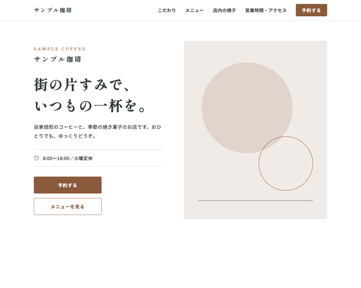

# BcLpShopTheme

baserCMS5用の、飲食店・カフェ・小さな小売店の紹介と、来店予約・お問い合わせのための1ページ LP（ランディングページ）テーマです。
こだわり・メニューと価格表・店内の様子・お知らせ・営業時間とアクセス・予約フォームまでを、
BurgerEditor のブロック操作と管理画面の設定だけで編集できます。

## 主な機能

- **1ページ LP**：トップの固定ページ1枚に、セクションを BurgerEditor のブロックで並べる構成
  - ヒーロー／こだわり／メニュー（おすすめ3品・価格表）／店内の様子／お知らせ／営業時間・アクセス（地図）／よくある質問／予約・お問い合わせ（CTA）
  - セクションの追加・削除・並べ替えは、ブロック操作だけでできる
- **お知らせはブログ**：ブログ「お知らせ」の最新記事が、LP のお知らせに自動で並ぶ（ショートコード `[Lp.news]`）。記事の一覧・詳細ページも LP と同じデザイン
- **ページ内ナビの自動生成**：大見出しブロックの「ID設定」に英字（例 `menu`）を入れると、ヘッダーのナビに載る。
  見出しの上には ID から作った英字のラベル（`MENU`）が出る。`-and-` は ` & ` になる（`hours-and-access` → `HOURS & ACCESS`）
- **予約・お問い合わせフォーム**：入力 → 確認 → 完了の3画面。ご希望の日付はカレンダーで選べる。項目は管理画面のメールフィールドで追加・並べ替えできる
- **テーマ設定の4色**で全体の配色が変わる（メイン／サブ／リンク／ホバー）。どの色にしても文字が読みやすいよう、文字の濃さと白黒を自動で調整する。ロゴもテーマ設定で変更できる
- **初期データ**：見本サイト一式（`default`、お知らせの記事3件を含む）と、最小構成（`empty`）
- レスポンシブ（PC／スマホ）、`prefers-reduced-motion` 対応

## 動作環境

- baserCMS5.4以上
- BurgerEditor（BcBurgerEditor）プラグインが有効であること
- ブログ（BcBlog）プラグインが有効であること（お知らせに使う。baserCMS の標準プラグイン）

## インストール

1. `plugins/BcLpShopTheme` に配置
2. 管理画面 > プラグイン管理 で BcBurgerEditor と BcBlog が有効になっていることを確認
3. 管理画面 > テーマ管理 で BcLpShopTheme を適用
4. 同じ画面で初期データ `default`（見本サイト）または `empty`（最小構成）を読み込む

> 初期データを読み込むと、ユーザー以外のデータ（固定ページ・メールフォーム・ブログ・サイト基本設定など）は初期化されます。
> 運用中のサイトでは読み込まないでください。

## 使い方

### 編集できる場所

| 内容 | 編集する場所 |
|---|---|
| 本文（全セクション） | 固定ページ「トップページ」の BurgerEditor |
| お知らせの記事 | ブログ「お知らせ」 |
| ロゴ・配色 | テーマ設定 |
| ヘッダーのナビ | 本文の大見出しブロックの「ID設定」（自動で作られる） |
| ヘッダーの「予約する」ボタンのリンク先 | 自動（公開中の最初のメールフォーム） |
| フォームの説明文・完了メッセージ・項目 | メールフォームの設定・メールフィールド |
| フッター（店名・住所・電話・営業時間・SNS） | ウィジェットエリア「フッター」のテキストウィジェット |

### 本文ブロックの独自 class

ブロック設定の「独自class設定」に入れると、決まった見た目になります。
一覧と中身の書き方は `webroot/css/bge_style.css` の冒頭にあります。

| 独自 class | 使うブロック | 見た目 |
|---|---|---|
| `sh-blk--hero` | 画像右寄せ（テキスト回り込み無し） | ヒーロー（英字の店名・店名・キャッチ・紹介文・営業時間・ボタン2つ。写真が空なら円と線の図形） |
| `sh-blk--section` | 大見出し | セクション見出し（英字ラベル＋右へ伸びる罫線。ID 設定でナビと英字ラベル） |
| `sh-blk--nonav` | 大見出し（`sh-blk--section` と併用） | ナビに載せない |
| `sh-blk--center` | 大見出し（`sh-blk--section` と併用）・任意 | 中央寄せ |
| `sh-blk--points` | 画像3列＋テキスト | こだわりのカード（「POINT 01」は自動） |
| `sh-blk--menu` | 画像3列＋テキスト | メニューのカード（最後の段落が価格） |
| `sh-blk--side` | 1カラムテキスト | 価格表の見出し（直後に `sh-blk--price` を置くと PC で左の列） |
| `sh-blk--price` | 2カラムテーブル | 価格表（価格は右寄せ） |
| `sh-blk--gallery` | 画像3列 | 写真を3枚並べる |
| `sh-blk--narrow` | 1カラムテキスト | 本文の幅を狭くする |
| `sh-blk--news` | 1カラムテキスト | 段落に `[Lp.news]` と書くと、お知らせの最新3件が並ぶ |
| `sh-blk--map` | GoogleMaps | お店の地図（直後に `sh-blk--info` を置くと PC で2列） |
| `sh-blk--info` | 2カラムテーブル | 店舗情報の表 |
| `sh-blk--faq` | 1カラムテキスト | よくある質問（すべて開いた状態） |
| `sh-blk--cta` | 1カラムテキスト | 予約の CTA（予約ボタンと電話の枠を横に並べる） |

ブロック設定の「背景色」は、テーマ色に置き換えています（ブルー＝メインの薄い色／グレー＝サブの薄い色／ピンク＝サブの濃い色）。

### お知らせ（ショートコード）

- 1カラムテキストのブロックの段落に `[Lp.news]` と書くと、公開画面ではブログ `news` の最新3件に置き換わります（編集エリアでは、点線の枠と説明が出ます）
- ブログ名と件数を変えるときは `[Lp.news ブログ名,件数]`（例 `[Lp.news news,5]`）と書きます
- 「埋め込みタグ」ブロックの中に書くと置き換わりません。1カラムテキストに書いてください

### 複数の場所に書かれている値を変えるとき

次の値は複数の場所に書かれているので、それぞれ直してください。

- **営業時間・定休日**：ヒーロー／店舗情報（`sh-blk--info`）／予約の CTA（`sh-blk--cta`）／フッター（ウィジェット）／メールフィールド「ご希望の日付」の注意書き・「ご希望の時間」の選択肢
- **電話番号・住所**：店舗情報／予約の CTA／フッター／メールフォームの送信完了メッセージ
- **店名**：ヒーロー／フッター／メールフォームの差出人名・件名／テーマ設定のロゴの代替テキスト

### 配色の例

初期色はアースカラーです。テーマ設定の4色を変えると、次のような配色にできます。

| | 初期色（アースカラー） | 配色例（テラコッタ） | 配色例（セージ） |
|---|---|---|---|
| メイン | `#8a5a3b` | `#c8643b` | `#6b7f5a` |
| サブ | `#2e3a2f` | `#3d3128` | `#1f2421` |
| リンク | `#8a5a3b` | `#a24f2c` | `#55684a` |
| ホバー | `#6b4329` | `#7d3c21` | `#3f4e37` |

## 設定

### お店の地図（GoogleMaps ブロック）

- 管理画面 > システム設定 > サイト基本設定 で Google Maps API キーを登録してください
- キーの Google Cloud プロジェクトで、Maps JavaScript API・Geocoding API（編集画面の住所検索）・Maps Static API を有効にし、課金を設定してください
- Google のデモ用キーでは、地図の表示はできますが、編集画面の住所検索は使えません（地図をドラッグして位置を合わせてください）
- サイト基本設定の「GoogleMaps住所」は、このブロックには反映されません
- 公開するサイトで使うキーには、HTTP リファラーの制限を設定してください

### 予約フォーム

- 「ご希望の日付」はカレンダーで選べます（baserCMS に同梱の jQuery UI を、フォームの画面だけで読み込みます）
- 日付・時間・人数は「任意」です。メールフォームでは、ほかの項目（ご用件）の値によって必須を切り替えられないため、「ご来店の予約の場合はご記入ください」と注意書きを付けています

## 制限事項

- 営業時間・電話番号などは各ブロックに直接書くため、変更時は複数の場所を直す必要があります（上記「複数の場所に書かれている値を変えるとき」）
- 初期データを読み込むと、お知らせの記事の投稿日は、読み込んだ時刻になります（baserCMS のブログの仕様）
- 店舗情報の表（`sh-blk--info`）のセルには HTML を書けないため、電話番号はリンクになりません。予約の CTA とフッターの電話番号はリンクです
- フォーム画面の見出しの上の英字「RESERVATION & CONTACT」は、テンプレート（`templates/plugin/BcMail/Mail/default/*.php`）に書いています

## 同梱物・外部リソース

| 名前 | 用途 | ライセンス |
|---|---|---|
| [jQuery](https://jquery.com/) 3.7.1（`webroot/js/vendor/`） | BurgerEditor の公開側スクリプト（地図・YouTube・画像ポップアップ）と、日付のカレンダーの動作に必要 | MIT |
| jQuery UI 1.11.4 | 日付のカレンダー（baserCMS の bc-front に同梱のものを読み込む。このテーマには同梱していない） | MIT |
| [Google Fonts](https://fonts.google.com/)（Noto Sans JP・Shippori Mincho） | 本文・見出しのフォント（CDN から読み込み。同梱はしていない） | SIL Open Font License 1.1 |
| アイコン（`bge_style.css`・テンプレート内の SVG） | 時計・電話・完了のアイコン | [Lucide](https://lucide.dev/) のアイコンをもとにしている（ISC License） |

## ライセンス

MIT License
